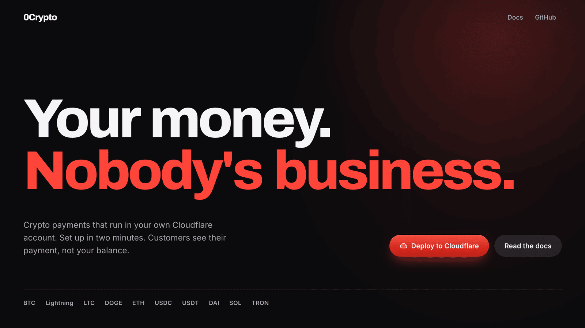
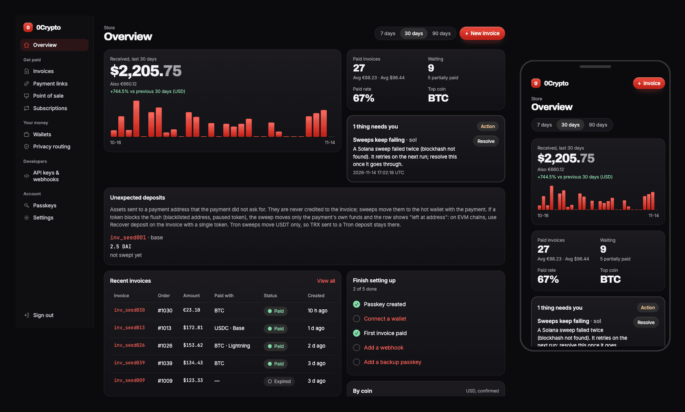
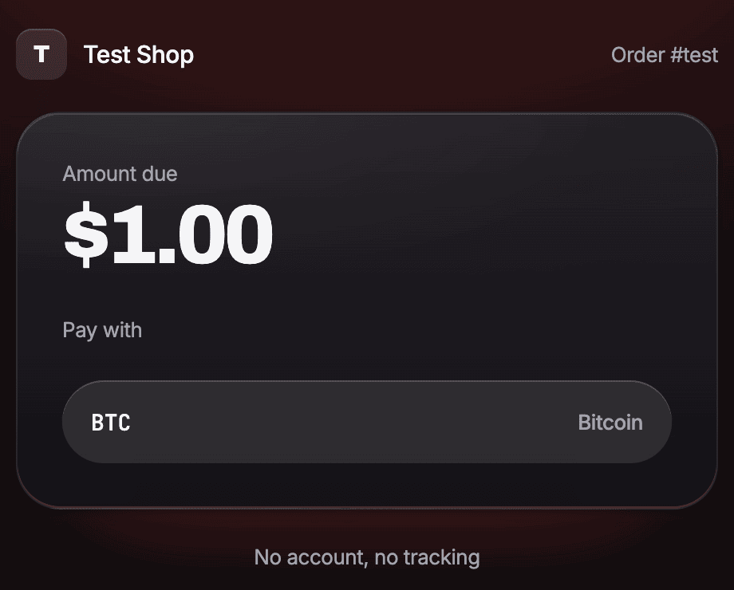
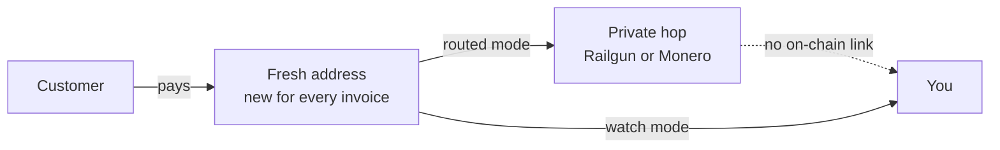

<div align="center">



# 0Crypto

**Crypto payments that run in your own Cloudflare account.**<br>
Set up in two minutes. Customers see their payment, not your balance.

[](https://deploy.workers.cloudflare.com/?url=https://github.com/0bull/0Crypto)

[](LICENSE)
[](https://workers.cloudflare.com)


[Quick start](#quick-start) · [Docs](#docs) · [Coins](#coins-and-networks) · [Security](#security) · [Develop](#develop)

</div>

---

0Crypto is a self-hosted crypto payment gateway. You create an invoice in your own currency, the customer picks a coin and pays to a fresh address, and 0Crypto watches the chain and tells your shop with a signed webhook. It is one Cloudflare Worker in your account: no middleman, no 0Crypto fee, no customer accounts.

<div align="center">

</div>

## What you get

|  |  |
| --- | --- |
| **Your own Cloudflare account** | Runs as a Worker you own. You pay Cloudflare's plan, plus network and swap costs only if you turn on routed mode. |
| **Watch-only wallets** | For BTC, LTC and DOGE you paste your wallet's public key. Payments land in your wallet and the Worker cannot spend them. |
| **Passkey sign-in** | The dashboard uses a passkey on your phone or laptop. No password to steal, and money actions ask for the passkey again. |
| **Connects to your shop** | Signed webhooks, a WooCommerce plugin, payment links and a REST API. |
| **Point of sale and subscriptions** | Take payments at the counter from a tablet, or send invoices that repeat on a schedule. |
| **Optional privacy routing** | In routed mode, received funds can move through Railgun or a swap to Monero before they reach your own wallet. |

## What your customer sees

A quiet checkout page with the amount, the coins you accept and a QR code. No sign-up and no tracking. Every invoice gets its own address, so a customer who looks up their payment on a block explorer sees their payment, not your balance.

<div align="center">

</div>

The trail stops before it reaches you:



## Quick start

You need a Cloudflare account (Workers Paid plan) and about ten minutes, most of it waiting for the first build.

1. **Deploy.** Press the **Deploy to Cloudflare** button above. Keep the name `0crypto` and press **Create and deploy**. Cloudflare creates the database and the queues for you.
2. **Claim it.** Open your new Worker's address and go to `/admin`. It asks for a setup code: six words printed in the Worker's logs (**Workers & Pages → 0crypto → Logs**). Nobody without access to your Cloudflare account can claim it.
3. **Create your passkey.** Your phone or laptop saves it. That is your sign-in from now on.
4. **Connect a wallet.** Paste your Bitcoin wallet's public key (xpub or zpub), or pick other coins.
5. **Take a test payment.** The welcome wizard creates a $1 test invoice so you can watch a payment arrive.

The step-by-step guide is in the [docs](site/src/content/docs/docs/deploy.mdx). Prefer the terminal? See [Deploy by hand](site/src/content/docs/docs/deploy.mdx#deploy-by-hand-developers).

## Coins and networks

| Coin | Network | Mode | How it works |
| --- | --- | --- | --- |
| BTC | Bitcoin | Watch | Your wallet's xpub or zpub. Payments land in your wallet. |
| LTC | Litecoin | Watch | Your wallet's Ltub. Payments land in your wallet. |
| DOGE | Dogecoin | Watch | Your wallet's dgub. Payments land in your wallet. |
| BTC | Lightning | Lightning | Nostr Wallet Connect to a wallet you already run. Receive-only. |
| ETH, USDC, USDT, DAI | Ethereum, Base, Arbitrum, Polygon, BNB Chain | Routed | Swept to a hot wallet per chain. Base has no USDT. |
| USDT | Tron | Routed | Swept to a hot wallet on Tron. TRX sent to a deposit address is not recovered. |
| SOL, USDC | Solana | Routed | Swept to a hot wallet on Solana. |

**Watch mode** holds no key that can spend: the Worker only watches addresses from your wallet's public key. **Routed mode** derives addresses from a seed phrase stored as a Worker secret, so it can sweep funds and route them privately. See [routed mode](site/src/content/docs/docs/advanced/routed-mode.mdx).

## Docs

The docs site lives in [`site/`](site) (Astro and Starlight). The pages are plain MDX you can read right here:

| Get started | Sell | Advanced | Run it |
| --- | --- | --- | --- |
| [Deploy](site/src/content/docs/docs/deploy.mdx) | [WooCommerce](site/src/content/docs/docs/sell-online/woocommerce.mdx) | [Routed mode](site/src/content/docs/docs/advanced/routed-mode.mdx) | [Security](site/src/content/docs/docs/security.mdx) |
| [Setup code](site/src/content/docs/docs/setup-code.mdx) | [Payment links](site/src/content/docs/docs/sell-online/payment-links.mdx) | [EVM, Tron, Solana](site/src/content/docs/docs/advanced/evm-tron-solana.mdx) | [Upgrading](site/src/content/docs/docs/upgrading.mdx) |
| [Passkey](site/src/content/docs/docs/passkey.mdx) | [API](site/src/content/docs/docs/sell-online/api.mdx) | [Lightning](site/src/content/docs/docs/advanced/lightning.mdx) | [Custom domain](site/src/content/docs/docs/custom-domain.mdx) |
| [Wallet](site/src/content/docs/docs/wallet.mdx) | [Webhooks](site/src/content/docs/docs/webhooks.mdx) | [Privacy routing](site/src/content/docs/docs/advanced/privacy-routing.mdx) | [Troubleshooting](site/src/content/docs/docs/troubleshooting.mdx) |
| [First payment](site/src/content/docs/docs/first-payment.mdx) | [Point of sale](site/src/content/docs/docs/point-of-sale.mdx) · [Recurring](site/src/content/docs/docs/recurring.mdx) | | [Operator notes](docs/deploy.md) |

To browse the site locally:

```sh
cd site
npm ci && npm run dev
```

## Develop

```sh
npm ci
cp .dev.vars.example .dev.vars
npm run dev        # wrangler dev on http://localhost:8787
npm test           # Workers and Node test suites
npm run typecheck
```

Under `npm run dev` (plain `http://localhost`) the admin and POS cookies are set without the `Secure` flag, because Safari drops Secure cookies over http even on localhost; every https request keeps it.

If your local D1 database was created before the rename to 0Crypto, reset it once with `rm -rf .wrangler/state`, then `npx wrangler d1 migrations apply DB --local`.

The WooCommerce plugin lives in [`plugins/woocommerce`](plugins/woocommerce) and has its own tests: `npm run test:woo`.

## Security

- The 24-word seed phrase is shown once by `npm run setup` and stored nowhere except as an encrypted Worker secret. If you lose it and use routed mode, funds at deposit addresses are unrecoverable. Back it up offline (paper or metal), never in cloud notes or chat.
- Anyone with the seed controls all routed-mode funds. In routed mode (`ALLOW_SEED_CUSTODY="true"`; always the case for EVM, Tron and Solana) the Worker holds the keys. Treat access to your Cloudflare account and its secrets the same way. Never reuse one `MASTER_SEED` across deployments.
- Prefer watch mode (xpubs from a wallet you control) if you do not want the Worker to hold spending authority at all. In watch mode the seed from `npm run setup` derives nothing; routed mode only uses it with `ALLOW_SEED_CUSTODY="true"`.
- Rotate `WEBHOOK_SECRET` with `wrangler secret put WEBHOOK_SECRET` and update your server at the same time.
- Privacy is limited. EVM forwarders sink into one hot wallet, Tron and Solana deposits are swept into one, and UTXO spends merge inputs. A customer who follows their own payment on a block explorer can see the hot wallet and other deposits until privacy routing moves them. Routing reduces this; it does not remove it.
- Refunds: at most one refund per hour, and only one runs at a time. Every approved refund raises an alert and a `refund.approved` webhook, both recorded before anything is sent. If you did not make that refund, sign out every session on the Passkeys page and cancel it on its refund page.
- Set `SUCCESS_URL_HOSTS` on the Settings page to limit `success_url` to your own hostnames (exact match, no subdomains, port ignored; list `localhost` too if you test locally); unset, any https URL is accepted. It applies to invoices created after it is set; earlier invoices keep their `success_url`.

Found a vulnerability? Please open a private security advisory on this repository instead of a public issue.

## Legal note

Self-host 0Crypto for **your own business only**. Running one instance to accept money on behalf of other merchants makes you a custodian, which falls under money transmitter rules (for example MSB in the US) or crypto-asset service provider rules (MiCA in the EU). There is no multi-merchant model in the code, by design. Get advice for your own jurisdiction.

## License

[MIT](LICENSE) © 0bull
